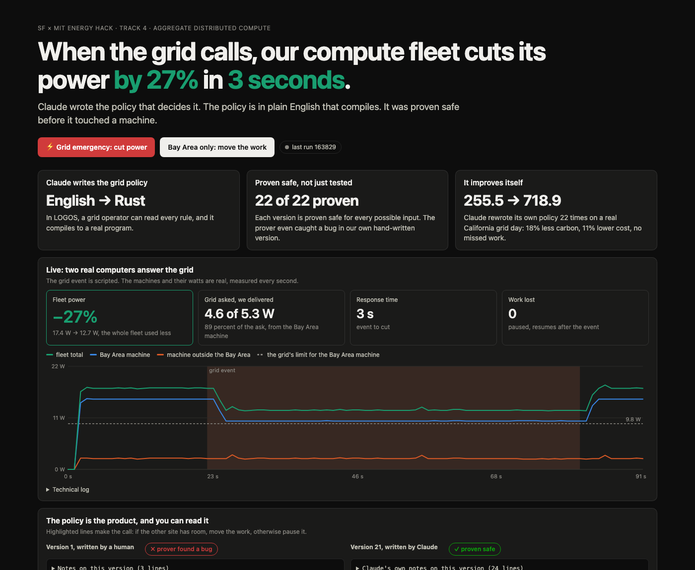

# A fleet the grid can call on

**SF × MIT Energy Hack Day, AGI House SF, 2026-11-08. Track 4: aggregate distributed compute.**

Many small compute sites act as one resource the grid can call on. Claude writes the scheduling policy in
[LOGOS](https://logicaffeine.com), an English language that compiles to Rust. A simulator replays a real
California grid day and scores the policy. Every version is proven safe for every possible input with
`largo prove` before it can run anywhere. The best proven policy then runs on two real machines, and when the grid
calls an event you can watch their power drop.



**Watch the video (2.5 minutes):** [docs/launch-video.mp4](docs/launch-video.mp4) (every number in it is sourced in [docs/launch-video-sources.md](docs/launch-video-sources.md)).

## What happens

1. **Real grid day.** CAISO real-time 5-minute prices at three hubs (NP15, ZP26, SP15), plus carbon intensity and
   demand, for Saturday 2026-11-07. A demand response event is scripted on top, shaped like an OpenADR event:
   the Bay Area (NP15) zone, shed 35 percent, 17:00 to 20:00.
2. **Claude writes a policy.** For each site and each 5-minute interval, the policy answers three questions: how
   much batch work to **pause**, how much to **move** to another site, and how much extra to **boost** now.
   Claude sees only the contract, the safety rules, the best policy so far and every earlier score. It never
   sees the simulator code, the score weights or the data.
3. **The simulator scores it.** Six synthetic sites with a combined peak above the 100 kW minimum in FERC Order
   2222. Score = delivery accuracy, response time, missed work, energy cost and carbon.
4. **`largo prove` proves it safe.** Four rules, for every possible input, each case checked by the LOGOS kernel:
   1. pause, move and boost are never negative.
   2. pause plus move never exceeds the site's batch work.
   3. move never exceeds the receiving site's spare room.
   4. boost never exceeds the site's own spare room.
5. **Repeat.** Each round, Claude reads the history and writes the next version.
6. **Real machines.** The best *proven* version runs on two small Intel N100 computers. One plays a Bay Area
   site and the other a site outside the Bay Area. Power is Intel RAPL package power, read once a second.

## Results

**The agent improves over the run** (`policy/leaderboard.json`, same replayed day for every version):

| | v001, the starting baseline | v021, Claude's best |
| --- | --- | --- |
| Score | 255.5 | 718.9 |
| Carbon over the day | 491.1 kg | 402.2 kg (18 percent less) |
| Energy cost | $89.46 | $79.92 |
| Batch work missed | 20.5 kWh | 0 |
| Proven safe | **No** | Yes |

- v001 is a deliberately simple starting baseline: pause what the grid asks for, nothing else. Claude Code wrote it
  directly, before the improvement loop existed. No human wrote any of the policies.
- Claude's first version in the loop (v002) already scored 665.6. It found "elastic bursting" on its own: move work out of
  the event zone instead of only pausing it.
- Later versions learned to shift batch work into clean, cheap midday solar hours and to catch up before the
  deadline. The policy's own `#` comments explain each change (`policy/versions/`).
- All 22 versions Claude wrote in the loop are proven safe, each in 6 to 37 seconds. **The starting baseline is
  the only one that fails.** The prover found that a negative grid target makes it return a negative pause. The
  simulator never sends one, so testing never caught it.
- To check the prover isn't passing everything, we planted a bug in v021 that overshoots its power limit by one
  watt, but only above 1,000,000 W, which the simulator never reaches. The prover rejected rule 4 and named the
  input that breaks it.

**Real machines** (`live/runs/`, the same v021 binary):

| Event | Bay Area machine | Delivered | Fleet total | Work lost |
| --- | --- | --- | --- | --- |
| Bay Area only: work moves to the other machine | 15.0 W to 10.2 W | 4.8 W of 5.25 W asked, about 3 s | 17.4 W to 19.5 W | none |
| Statewide: nowhere to move, work pauses | 15.0 W to 10.3 W | 4.7 W of 5.25 W asked | 17.4 W to 12.6 W | none, paused work resumes after the event |

Moving work gives the event zone its cut without losing work, but the fleet as a whole uses slightly more,
because a second machine wakes up. Only pausing lowers total energy. The policy chooses between the two from
the situation it is given, and the dashboard shows both.

## How this maps to Track 4

| Track 4 asks for | Here |
| --- | --- |
| Power delivered versus committed | Delivery accuracy in every simulated score, and measured live in watts |
| Response time | Scored in simulation, measured live (about 3 seconds to the cut) |
| Minimum size met | The simulated fleet peaks above FERC Order 2222's 100 kW |
| Dashboard, site map, accuracy across iterations | `dashboard/`: live panel, score per version, site map, zone and price charts, both policies' source side by side |

## What is real and what is not

- **Real:** the CAISO grid day, the Azure trace shape, the two machines, their watts, the compiled policy that
  runs on them, the proofs.
- **Scripted:** the demand response event. The grid day itself had no price spike.
- **Synthetic:** the six-site fleet in the simulator. The live machines are about 15 W each, far below any
  program minimum.
- **Carbon** is the grid-average intensity, not the marginal plant.
- **RAPL** measures the processor package, not the whole machine at the wall.
- **Proof scope.** One step, that "not a < b" means "b ≤ a" for integers, is trusted outside the kernel. 64-bit
  overflow is not modelled. The rules need a `largo` build that can state inequalities in English theorems and
  apply the policy's own functions inside them. That support was added to LOGOS during the hackathon and is not
  in a release yet.
- **Network.** The laptop reaches the machines over SSH. In our run, the Bay Area machine's commands and power
  readings crossed our own private WireGuard mesh from the other machine. No connection details are in this
  repository: each person supplies their own in a local, gitignored file (see [docs/SETUP.md](docs/SETUP.md)).

## Run it

Python 3.12 standard library only. Building policies needs `largo` (LOGOS 0.11). The agent loop needs the
`claude` CLI.

```bash
python3 -I dashboard/serve.py                              # then open http://localhost:8765
python3 -I loop.py --iterations 10                         # more rounds of the agent (about a minute each)
policy/build.sh policy/versions/v021.lg                    # compile one version to policy/bin/v021
python3 -I sim/simulate.py --policy policy/bin/v021        # score it
policy/prove.sh policy/versions/v021.lg                    # prove the four rules (set LARGO_PROVE)
python3 -I live/live.py --policy policy/bin/v021 --scope statewide   # live run, needs the two machines
```

**To try it in your own environment, follow [docs/SETUP.md](docs/SETUP.md).** The simulator, the agent loop
and the dashboard need no hardware. The live run needs two Linux machines of your own, named in a local config
file that never leaves your laptop.

## Layout

```text
data/        the real grid day, its raw CAISO and Azure files, and build_trace.py
sim/         simulate.py, sites.json (the six synthetic sites), event.json (the scripted event)
policy/      harness_head.lg and harness_main.lg (fixed), rules.lg (the four theorems),
             versions/vNNN.lg (every version, with its score and proof output), leaderboard.json,
             proofs/ (what was proven), run1/ (the first run under an older two-decision contract)
loop.py      the agent loop: Claude writes, largo builds, the simulator scores, largo proves, repeat
live/        drnode.py (runs on each machine), live.py (fires the event), runs/ (every live run)
dashboard/   serve.py and index.html, no external requests
docs/        SETUP.md (run it yourself) and the dashboard screenshot
```

## Data

CAISO OASIS and CAISO Today's Outlook public data, and the Azure Public Dataset LLM inference trace (CC BY 4.0).
Sources and caveats are in [`data/README.md`](data/README.md).

## License

MIT, see [LICENSE](LICENSE). The data files keep their own terms (see `data/README.md`).
